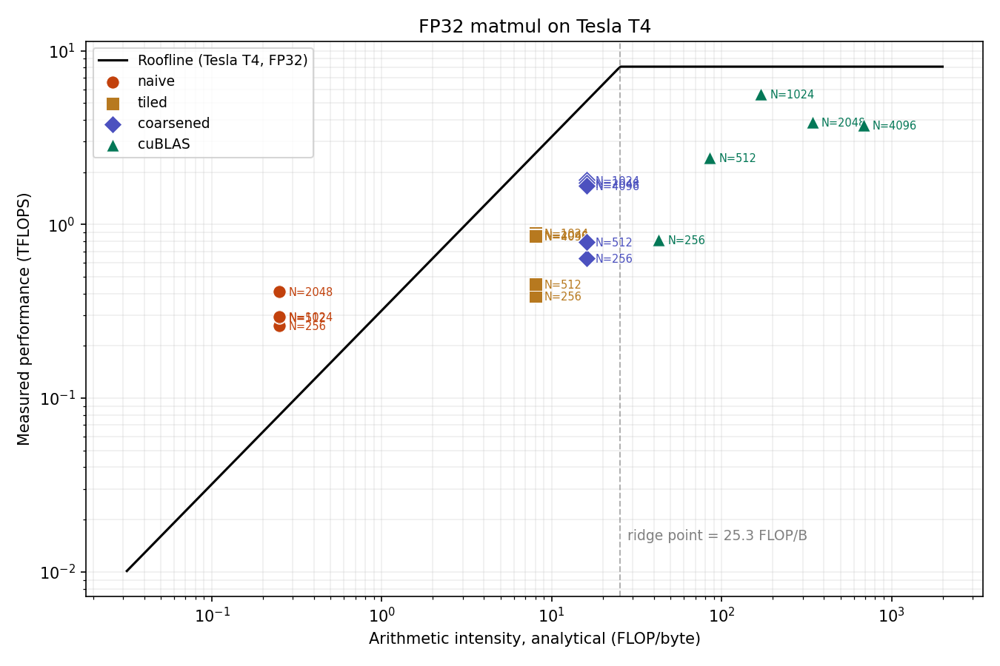

# CUDA matmul on the Roofline

[](https://colab.research.google.com/github/djameledinekh-lab/cuda-matmul-roofline/blob/main/notebooks/run_on_colab.ipynb)

Three hand-written FP32 matrix-multiplication kernels in CUDA, benchmarked against `torch.matmul` (cuBLAS) and placed on a Roofline model of an NVIDIA T4.

The project started as a port of an OpenCL matmul lab I did on an NVIDIA A100. The question it answers: how far does each classic optimization move a kernel along the Roofline, and what limits it next?



## Kernels

All three live in [`csrc/matmul_kernels.cu`](csrc/matmul_kernels.cu) and are built as a PyTorch C++ extension.

| Kernel | Idea | Threads per block |
|---|---|---|
| `naive` | One thread per output element; every operand comes from DRAM | 16 × 16 |
| `tiled` | 32 × 32 tiles of A and B staged in shared memory and reused 32 times | 32 × 32 |
| `coarsened` | 64 × 64 data tiles; each thread computes a `COARSE × COARSE` block of outputs from registers | (64 / COARSE)² |

## Roofline model

Peak FP32 on the T4 is 8.1 TFLOPS and DRAM bandwidth is 320 GB/s, so the ridge point is about 25 FLOP/byte.

The arithmetic intensity (AI) on the x-axis is **analytical**: FLOPs divided by the DRAM traffic implied by each kernel's access pattern ([`roofline.py`](roofline.py)). Nsight Compute is not available on Colab, so AI is modeled, not measured. The model ignores L1/L2 cache hits, which makes it a pessimistic bound for the naive kernel.

| Kernel | Analytical AI (FLOP/byte) |
|---|---|
| `naive` | 0.25 |
| `tiled` | 8 |
| `coarsened` | 16 (same as tiling with a 64 × 64 tile; coarsening only cuts shared-memory reads) |
| cuBLAS (ideal reuse) | N / 6 |

## Results

Measured on a Colab Tesla T4, FP32, mean of 20 runs after 5 warm-up runs. `% of cuBLAS` compares run times at the same N.

| Kernel | N = 1024 | N = 2048 | N = 4096 | % of cuBLAS (N = 4096) |
|---|---|---|---|---|
| naive | 0.30 TFLOPS | 0.42 TFLOPS | not run | — |
| tiled (32 × 32) | 0.80 TFLOPS | 0.89 TFLOPS | 0.88 TFLOPS | 23 % |
| coarsened, 2 × 2 outputs per thread | 1.80 TFLOPS | 1.73 TFLOPS | 1.68 TFLOPS | 45 % |
| coarsened, 4 × 4 outputs per thread | 2.54 TFLOPS | 2.18 TFLOPS | 2.17 TFLOPS | 57 % |
| cuBLAS (`torch.matmul`) | 5.71 TFLOPS | 3.87 TFLOPS | 3.81 TFLOPS | 100 % |

Full tables: [`results_tesla_c2.md`](results/results_tesla_c2.md) and [`results_tesla_c4.md`](results/results_tesla_c4.md). Roofline with 4 × 4 coarsening: [`roofline_tesla_c4.png`](results/roofline_tesla_c4.png).

## What limits each kernel

<!-- Write this yourself after reading the results: 3 to 5 sentences per kernel. -->

## Run it

On Colab, open [`notebooks/run_on_colab.ipynb`](notebooks/run_on_colab.ipynb) with a T4 runtime. On any machine with an NVIDIA GPU and PyTorch:

```bash
pip install -r requirements.txt
python bench.py              # COARSE=2
python bench.py --coarse 4   # 4 x 4 outputs per thread
```

`bench.py` checks every kernel against `torch.matmul` on a 300 × 300 problem (not a multiple of the tile size, to exercise the boundary checks), then writes a CSV, a Markdown table and the Roofline plot to `results/`.

## Next steps

- Double buffering of the shared-memory tiles to overlap loads with compute
- Vectorized `float4` loads from global memory
- Measuring real DRAM traffic with Nsight Compute on a machine that supports it

## License

MIT
